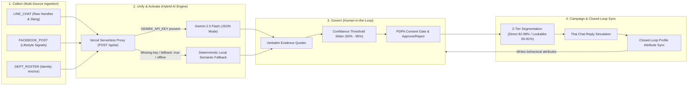

# Mini CDP — AI-Powered Customer Data Platform

**Mini CDP** is a self-serve AI Customer Data Platform built around four operational pillars: **Collect → Unify → Activate → Govern**. It resolves fragmented Thai and English customer signals across `LINE_CHAT`, `FACEBOOK_POST`, and `DEPT_ROSTER` into verified Single Customer Views, runs 2-tier semantic segmentation, and closes the loop by syncing live campaign responses back into customer profiles.

## System Architecture



## Core Workflow Tabs

1. **Collect & Unify (`CollectUnifyTab`):** Inspect unmerged multi-source records, run the 3-stage AI Identity Stitching pipeline (`Entity Resolution → Attribute Extraction → Confidence Governance`), test reversible `Unmerge / Re-merge` resolution, and triage low-confidence traits.
2. **Unified Profiles (`UnifiedProfilesTab` + `ProfileInspectorDrawer`):** Browse 15 Computing department profiles, filter by Thai lifestyle tags or `Needs Review`, inspect verbatim source quotes, approve or reject traits, and toggle `Formatted / Raw JSON`.
3. **AI Segmentation (`CampaignSegmentTab`):** Choose Thai campaign presets or enter any custom prompt to discover **Tier 1: Direct Match** (`82–98%`) and **Tier 2: Lookalike / Vibe Match** (`65–81%`) targets, customize LINE invites in the Message Studio, and launch campaigns while shielding `PDPA Opt-Out` records.
4. **Campaign & Loop (`AnalyticsLoopTab`):** Track `Total Sent`, `Accepted Rate`, `Lookalike Conversion`, and `Closed-Loop Profile Updates`, simulate Thai chat replies, and verify new behavioral attributes written directly back onto `UnifiedProfile` records.
5. **AI Lead X-Ray Mode (`XRayDrawer`):** Inspect the 4-pillar architecture, `src/types/cdp.ts` TypeScript schema, live sample JSON, and real-time `PipelineLog[]` execution latencies.

## Key Engineering Highlights

- **Hallucination Mitigation & Grounding:**
  - All Gemini requests enforce `generationConfig: { responseMimeType: "application/json" }` and strict schema alignment with `src/types/cdp.ts`.
  - Every `ExtractedAttribute` carries a verbatim `evidenceQuote` substring traced directly to its source record (`LINE_CHAT`, `FACEBOOK_POST`, or `DEPT_ROSTER`).
  - A global **Confidence Threshold Slider** (`50%–95%`, default `75%`) dynamically flags attributes below the gate as `Needs Review` for explicit human **Approve / Reject** governance.
- **Zero-Downtime Hybrid AI Resilience:**
  - Browser code never holds or sends `GEMINI_API_KEY`. Every AI call goes through `POST /api/ai` (`api/ai.ts`) with a 4-second client timeout (`src/services/aiEngine.ts`).
  - When `GEMINI_API_KEY` is unset or the upstream endpoint is unreachable (including standard local `vite` dev), `/api/ai` returns `{ fallback: true }` with HTTP `200`, seamlessly activating the deterministic local Thai/English semantic engine with identical output contracts.
- **Strict Enterprise UI & Accessibility:**
  - Built with React 19, TypeScript (`strict: true`), Tailwind CSS v4 (`@theme` tokens in `src/index.css`), Framer Motion (`MotionConfig reducedMotion="user"`), and Lucide icons.
  - Native modal `<dialog>` drawers with `overscroll-behavior: contain`, `tabular-nums` on all scores/latencies/KPIs, and visible `focus-visible` rings across all controls.

## Project Structure

```text
api/
  ai.ts                           # Vercel Serverless Gemini 2.5 Flash proxy + { fallback: true }
src/
  components/
    AnalyticsLoopTab.tsx          # Tab 4: KPIs, reply simulation & closed-loop sync
    CampaignSegmentTab.tsx        # Tab 3: Preset/custom segmentation & Message Studio
    CollectUnifyTab.tsx           # Tab 1: Ingestion queue, identity stitching & unmerge/re-merge
    DrawerShell.tsx               # Native modal <dialog> + Framer Motion slide-over wrapper
    LoginGate.tsx                 # 1-click demo workspace & X-Ray entry
    ProfileInspectorDrawer.tsx    # Profile evidence quotes, governance & Raw JSON inspector
    ToastRegion.tsx               # Accessible polite live-region notifications
    TopNavbar.tsx                 # Sticky navbar, workflow tabs, threshold slider & X-Ray switch
    UnifiedProfilesTab.tsx        # Tab 2: Searchable 15-profile grid & quick filters
    XRayDrawer.tsx                # Architecture, TypeScript schema & live AI pipeline logs
  data/
    seedData.ts                   # 15 Computing Dept profiles, 45 raw records & CAMPAIGN_PRESETS
  services/
    aiEngine.ts                   # Hybrid AI client + deterministic Thai semantic fallback engine
  types/
    cdp.ts                        # Strict CDP TypeScript contracts
  utils/
    cdpHelpers.ts                 # Shared styling tokens, effective governance status & formatters
  App.tsx                         # Root state orchestration
  index.css                       # Tailwind v4 @theme design system & accessible slider/dialog CSS
vercel.json                       # /api/* serverless routing & SPA /index.html fallback
```

## Quick Start & Environment Setup

### 1. Install dependencies

```bash
npm install
```

### 2. Run locally (Deterministic Local AI Mode)

```bash
npm run dev
```

No API key is required for local development — all three AI workflows (`stitch`, `segment`, `simulate_replies`) seamlessly use the deterministic local semantic engine when `/api/ai` is unavailable or `GEMINI_API_KEY` is unset.

### 3. Optional: Enable Live Gemini 2.5 Flash via Vercel

Add `GEMINI_API_KEY` as a server-side environment variable in Vercel Project Settings (or `.env.local` when running `vercel dev`):

```bash
GEMINI_API_KEY=your_gemini_api_key_here
```

### 4. Typecheck, Lint, and Production Build

```bash
npx tsc -b --noEmit
npm run lint
npm run build
```
